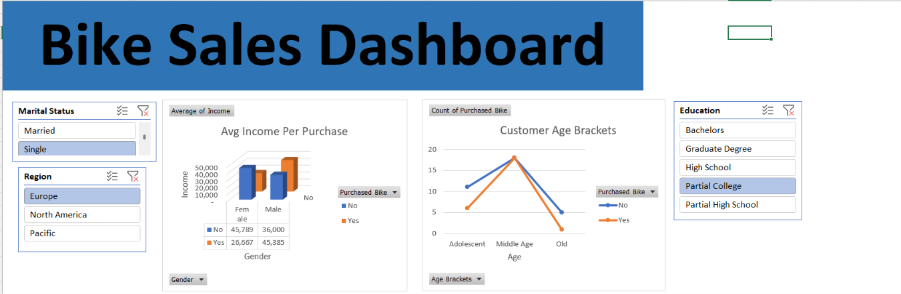
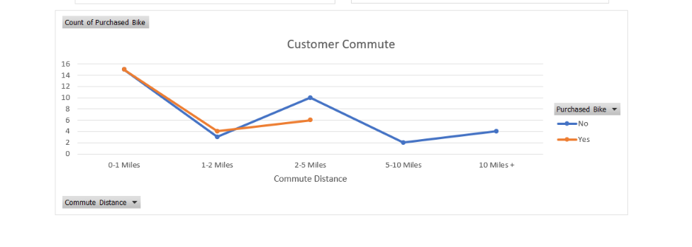

# Bike Sales Analysis Dashboard | Microsoft Excel

## Project Overview
This project focuses on analyzing bike sales and customer purchasing behavior using Microsoft Excel.

The objective is to explore customer demographics, income levels, occupations, age groups, and commute distances to understand the factors associated with bike purchasing decisions.

## Tools & Technologies
- Microsoft Excel
- Data Cleaning
- Pivot Tables
- Pivot Charts
- Data Visualization
- Interactive Dashboard

## Dataset Description
The dataset contains customer information, including:
- Customer ID
- Marital Status
- Gender
- Income
- Number of Children
- Education
- Occupation
- Home Ownership
- Number of Cars
- Commute Distance
- Region
- Age
- Age Brackets
- Purchased Bike

## Project Workflow

### 1. Data Preparation
- Prepared the dataset for analysis.
- Standardized marital status and gender values.
- Created age brackets to categorize customers.

### 2. Data Analysis
- Analyzed customer purchasing behavior.
- Used Pivot Tables to summarize customer information.
- Explored relationships between customer demographics and bike purchases.

### 3. Dashboard Creation
Created a Bike Sales Dashboard with visualizations covering:
- Average Income
- Customer Commute Distance
- Customer Age Brackets

## Key Findings
- The dataset contains 1,000 records in the working sheet.
- 481 customers purchased bikes, while 519 did not.
- Middle-aged customers represent the largest age group.
- Customers commuting 0–1 miles represent the largest purchasing group by commute distance.

## Project Files
- `Excel Project Dataset.xlsx` – Complete Excel workbook containing the dataset, working sheet, Pivot Tables, charts, and dashboard.

## Dashboard Preview

## Data Analysis Preview

## Conclusion
This project demonstrates practical data analysis skills using Microsoft Excel, including data preparation, Pivot Table analysis, data visualization, and dashboard development.

